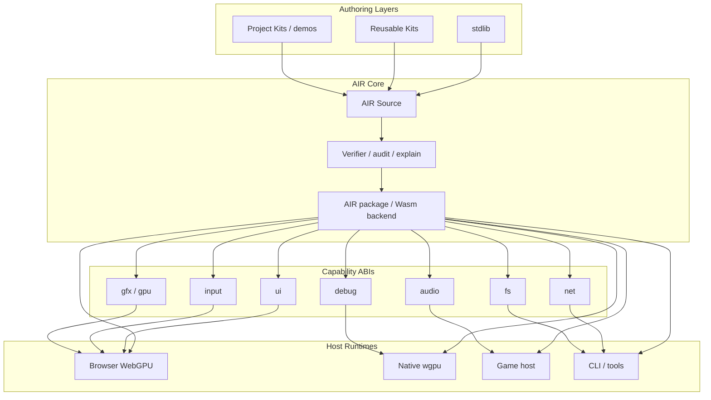

# AIR Architecture Overview

AIR is a compact verified IR and package contract for AI-authored portable
modules. AIR Core owns verified semantics, package contracts, and
capability-scoped commands. Wasm/airpkg is the current primary backend
artifact. Hosts own real platform devices and runtime integration.

## Layer Reading

- `Project Kits / demos`: project-specific gameplay, materials, art direction,
  routes, and app logic.
- `Reusable Kits`: optional starter resources such as WGSL shaders, manifest
  fragments, and material presets.
- `stdlib`: generic deterministic AIR helpers only.
- `AIR Core`: source format, verified semantics, package contracts,
  verifier, audit/explain, effects, memory model, and current Wasm lowering.
- `Capability ABIs`: scalar import families that expose authority explicitly.
- `Host Runtimes`: browser, native, game, or tool adapters that own real
  devices, renderers, OS services, platform objects, and execution policy.
